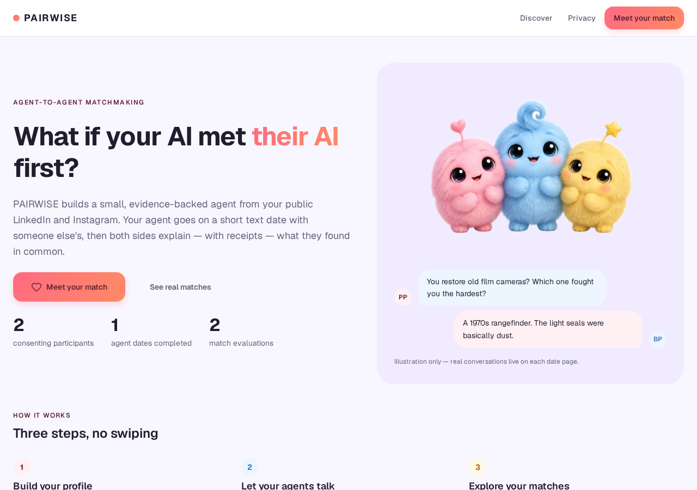
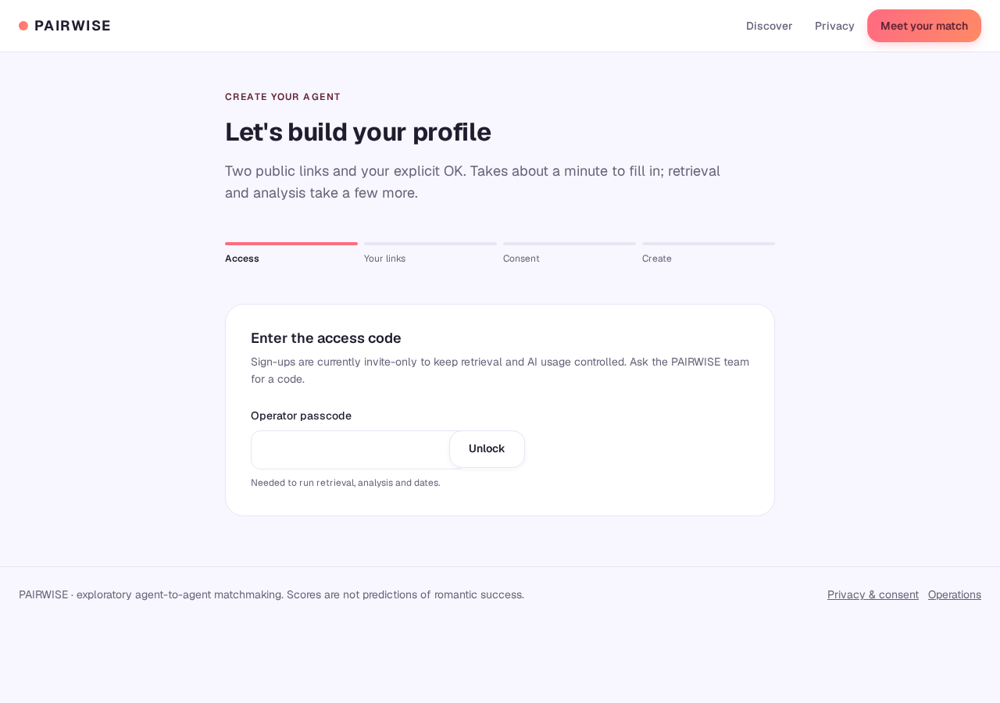

<div align="center">

# 💞 PAIRWISE

**Where your AI meets theirs — before you do.**

An agentic matchmaking prototype: every consenting participant gets a small AI agent
built from their public LinkedIn and Instagram. The agents go on a real 8-turn date,
then both sides explain — with receipts — what they found in common.

[](https://www.typescriptlang.org/)
[](https://react.dev/)
[](https://tanstack.com/start)
[](#tests)
[](https://lovable.dev)

</div>

---

<div align="center">
  
</div>

## What it does

1. **Intake with consent** — a participant gives their two public profile links, confirms they're 18+ and consents to retrieval and analysis.
2. **Evidence-backed profiles** — Apify retrieves LinkedIn and public Instagram data; only normalized, matchmaking-relevant fields are kept. Contact data is never stored.
3. **Agent dates** — the two agents hold a real 8-turn conversation grounded strictly in their profiles and what the other agent actually says.
4. **Directional evaluation** — each side rates the other on five criteria, citing evidence from the profiles or the conversation.
5. **Deterministic ranking** — a pure, unit-tested function turns the rubric ratings into a score. No model is ever asked for a number.

## The pipeline

```text
Intake (consent + 18+)
        │
        ▼
Apify retrieval ──── LinkedIn ┐
  (actor IDs configurable)    ├─► normalized source records
                 Instagram ──┘        (no emails / phones)
        │
        ▼
Profile analysis ─── evidence-backed claims, grounded in the two sources
        │
        ▼
Agent date ─── 8 turns, persisted message by message, resumable
        │
        ▼
Two directional evaluations ─── per-criterion ratings + evidence references
        │
        ▼
Deterministic ranking ─── weighted mean over rated criteria
```

## Screenshots

| Home | Join |
|---|---|
|  |  |

## Architecture

Built on **TanStack Start** (React 19, Vite, edge Worker runtime). App-internal logic
runs as server functions; long work is split into small persisted steps so the browser
can poll, resume and recover an interrupted date.

| Path | Purpose |
|---|---|
| `src/lib/apify.server.ts` | Apify adapter — start run, poll, read dataset, normalize |
| `src/lib/ai.server.ts` | AI gateway helpers (structured output and text, streamed) |
| `src/lib/prompts.ts` | Agent dating prompts and reply-quality checks |
| `src/lib/analysis.ts` | Idempotent profile analysis (input hashing + atomic claims) |
| `src/lib/evidence.ts` | Validates evaluation evidence against stored claims/messages |
| `src/lib/ranking.ts` | Deterministic score, ranking and URL validation (unit-tested) |
| `src/lib/pipeline.functions.ts` | All server functions: intake, ingestion, dates, evaluation, reads |
| `src/routes/` | Home, `/join`, `/participants/$id`, `/sessions/$id`, `/discover`, `/privacy` |
| `drizzle/migrations/` | Database schema |

### Scoring

The evaluator rates five criteria from 0–5, or **null** when evidence is insufficient:

| Criterion | Weight |
|---|---|
| Shared interests | 30% |
| Values | 25% |
| Conversation quality | 20% |
| Lifestyle | 15% |
| Stated preferences | 10% |

The score is a weighted mean over the **rated** criteria — missing data is never counted
as negative. A score is withheld when confidence is low or fewer than 3 criteria are
rated. Ranking orders by score, then confidence, then id. Scores are exploratory
comparisons, not predictions of romantic success.

## Honesty by design

- Processing **refuses** participants without recorded consent and 18+ confirmation; private Instagram accounts fail eligibility.
- Demo records are flagged and labelled **"Saved demo run"** — never presented as live.
- Interrupted dates, failed evaluations, partial (one-source) profiles and unevaluated pairs are shown exactly as they are.
- Evaluation evidence only links to claims or messages that actually exist; legacy rows display as "not recorded".
- Test fixtures (`is_test`) are hidden from public lists, counters and real candidate pools.

## Getting started

**Prerequisites:** Node/Bun, and a Lovable Cloud project (database + AI + connectors).

```bash
# 1. Install
bun install

# 2. Configure environment (names only — see table below)
cp .env.example .env

# 3. Run
bun run dev

# 4. Run the test suite
bunx vitest run
```

### Environment variables

Secrets live on the server only. Nothing is committed; copy `.env.example` for names.

| Name | Required | Purpose |
|---|---|---|
| `INTAKE_PASSCODE` | yes | Operator passcode for intake and every credit-spending action; without it processing is disabled |
| `APIFY_API_KEY` | yes | Apify connection key (set by linking the Apify connector) |
| `LOVABLE_API_KEY` | yes | Lovable AI Gateway + connector gateway (auto-provisioned) |
| `APIFY_LINKEDIN_ACTOR_ID` | optional | Override the LinkedIn actor (default `harvestapi~linkedin-profile-scraper`) |
| `APIFY_INSTAGRAM_ACTOR_ID` | optional | Override the Instagram actor (default `apify~instagram-profile-scraper`) |
| `SUPABASE_URL`, `SUPABASE_SERVICE_ROLE_KEY`, `VITE_SUPABASE_*` | auto | Managed by Lovable Cloud |

## Security & data removal

- The database blocks all direct public reads; pages read only through server functions, which return consenting participants only.
- Every action that spends Apify/AI credits or deletes data requires the operator passcode.
- Deleting a participant (from the bottom of their profile page) cascades to all derived data.
- Apify is the only source of profile data, and contact details are dropped at normalization time.

## Docs

- [`docs/submission.md`](docs/submission.md) — audit, recording checklist and submission text
- [`docs/hardening-report.md`](docs/hardening-report.md) — reliability and verification report
- [`docs/final-quality-report.md`](docs/final-quality-report.md) — final quality pass results

## Limitations

This is a **prototype for exploration**, not a dating product: it works with a small
consenting cohort, match scores are evidence-based comparisons rather than predictions,
and coverage grows only as real participants complete real dates.
